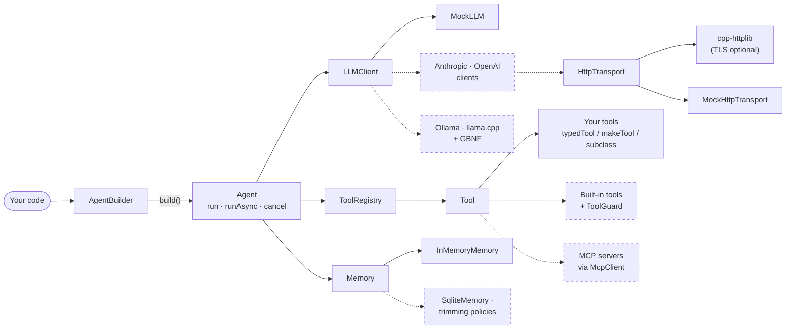
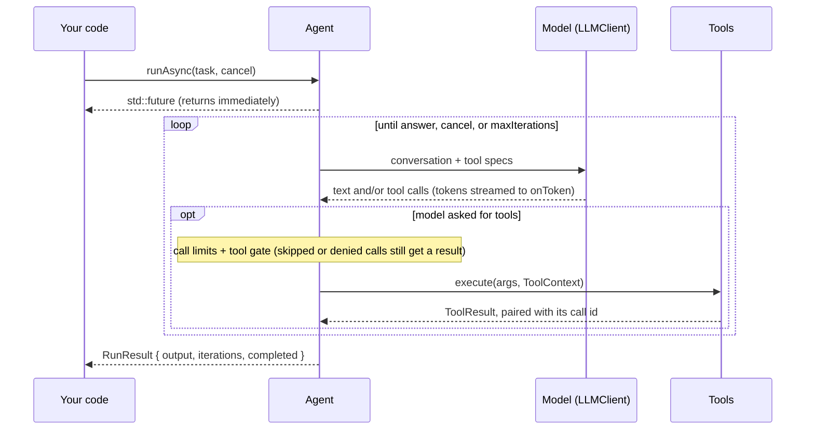

<div align="center">

# corvus

### The AI agent runtime for C++.

**Embed tool-using LLM agents directly in your C++ process.**<br/>
No Python. No sidecar. No blocked threads.

Built for code that can't stop: ROS2 nodes, game loops, drones, trading engines.<br/>
And it speaks [MCP](https://modelcontextprotocol.io), so the existing tool ecosystem is yours on day one.

[](https://github.com/Ambar-Gupta22/corvus/actions/workflows/ci.yml)
[](LICENSE)


[Quickstart](#quickstart) · [Why corvus](#why-corvus) · [Features](#features) · [Architecture](#architecture) · [Install](#install) · [Roadmap](#roadmap) · [FAQ](#faq) · [Docs](docs/README.md)

</div>

---

Every agent framework today assumes your program is written in Python. But a lot of the software that most needs an agent isn't: the robot's planner, the NPC's brain, the drone's mission controller, the strategy loop that can't afford a 40 ms hiccup. Today those teams embed a Python interpreter, bolt on a sidecar process, or hand-roll HTTP calls against each provider's API.

**corvus is the native alternative.** A small, embeddable C++17 library that gives you the full agent loop (model, tools, memory, streaming, cancellation) as ordinary C++ objects you link with CMake and call from any thread.

```cpp
auto agent = AgentBuilder().withModel(model).withTool(moveTo).build();
auto pending = agent.runAsync("Inspect the loading dock", cancel);  // your loop keeps running
```

> [!IMPORTANT]
> **Early development. Here is exactly what works today.**
>
> - ✅ **Shipped and tested:** the agent loop, typed tools, tool registry, memory, async runs with streaming and cancellation, the offline test harness, and a hardened HTTP transport. CI-gated on Linux, macOS, and Windows with ASan, UBSan, and TSan.
> - 🚧 **Landing now, PR by PR:** real model backends. Anthropic and OpenAI (Phase 1), local models via llama.cpp and Ollama (Phase 2), MCP (Phase 3). Until then, agents run against the built-in `MockLLM`.
> - `corvus` is a working name.
>
> ⭐ **Star or watch the repo** to follow along as the backends land.

## Quickstart

This runs today, offline, with no API key (a trimmed version of [`examples/mock_quickstart.cpp`](examples/mock_quickstart.cpp)):

```cpp
#include <iostream>
#include <corvus/corvus.h>

struct CalcArgs { std::string expression; };

int main() {
    using namespace corvus;

    // A tool is one expression. Its args arrive as a struct: corvus builds the
    // JSON Schema from the field list and parses each call into CalcArgs.
    auto calculator = typedTool<CalcArgs>("calculator", "Evaluates a simple arithmetic expression.")
        .field("expression", &CalcArgs::expression, "e.g. '2 + 2'")
        .run([](const CalcArgs& a) -> std::string { return "4"; });

    // A scripted model: first it calls the tool, then it answers.
    auto model = std::make_shared<MockLLM>();
    model->callTool("calculator", R"({"expression":"2 + 2"})").reply("2 + 2 = 4");

    auto agent = AgentBuilder().withModel(model).withTool(calculator).build();

    RunResult result = agent.run("What is 2 + 2?");
    std::cout << result.output << "\n";  // 2 + 2 = 4
}
```

**With a real model** (Phase 1, landing now), only the model line changes:

```cpp
auto agent = AgentBuilder()
    .withModel(anthropic("claude-haiku-5-5"))   // or openai(...), ollama(...)
    .withTool(calculator)
    .build();
```

> [!NOTE]
> Today `anthropic()`, `openai()` and `ollama()` throw a clear "lands in Phase 1" error. The API is fixed now, so your code doesn't change when the backends arrive.

## Why corvus

C++ has no LangChain, and the workarounds all cost you something:

| Workaround | What it costs |
|---|---|
| Embed a Python interpreter | The GIL, a second runtime to package and ship, latency spikes in your hot path |
| Run a Python sidecar | IPC, another process to supervise, a second failure domain |
| Hand-write HTTP per provider | Tool-call parsing, streaming, retries, and history formats rebuilt (and re-debugged) in every project |

corvus is built around three commitments:

1. **Native tool-calling, not prompt parsing.** Structured tool-use JSON for cloud models, grammar-constrained (GBNF) JSON for local llama.cpp models. ReAct-style text parsing is only a fallback.
2. **Async, streaming, and cancellation as first-class features.** `runAsync` returns a `std::future`, tokens stream through a callback, and a `CancelToken` is honored by the agent loop and by the HTTP transport on every network read. Built for processes that must never block.
3. **MCP-native.** Thousands of existing [MCP](https://modelcontextprotocol.io) servers become corvus tools with no glue code. *(Phase 3)*

### Where corvus fits

| | LangChain | llama.cpp | **corvus** |
|---|:-:|:-:|:-:|
| Language | Python | C/C++ | **C++17** |
| Embeds in a C++ process, no interpreter | ❌ | ✅ | ✅ |
| Agent loop: tools, memory, strategies | ✅ | ❌ inference only | ✅ |
| Cancel a run from your own thread | n/a | n/a | ✅ `CancelToken` |
| Plain CMake target (`find_package` / FetchContent) | ❌ | ✅ | ✅ |
| Cloud models (Anthropic, OpenAI) | ✅ | ❌ | 🚧 Phase 1 |
| Offline local models | ✅ | ✅ | 🚧 Phase 2 (via llama.cpp) |
| MCP tool ecosystem | ✅ via adapters | ❌ | 🚧 Phase 3 |

corvus doesn't compete with llama.cpp: llama.cpp runs the model, corvus runs the agent around it. And it isn't a LangChain port. It's the piece you reach for when your program is C++ and has to stay that way.

### Built for

| You're building | corvus gives you |
|---|---|
| 🤖 **ROS2 robots** | An agent that runs inside your node: `runAsync` from a timer callback, cancel on shutdown, robot actions exposed as typed tools. |
| 🎮 **Games (Unreal, custom engines)** | NPC reasoning off the game thread, with streamed dialogue tokens and a hard stop when the player walks away. |
| 🛩️ **Edge devices (Raspberry Pi, Jetson, drones)** | A single native library; fully offline with local models (Phase 2). No Python stack on the device. |
| 📈 **Low-latency systems** | No interpreter or GC in your process. The agent never owns your hot thread. |
| 🛠️ **Systems & tools** | An agent loop as a library you can test like the rest of your code, deterministically and offline. |

## Features

### Tools are typed C++, not hand-written JSON

Declare the arguments as a struct. corvus derives the JSON Schema the model sees **and** the parser from the same field list, so they can never drift apart:

```cpp
struct MoveArgs { double x = 0; double y = 0; std::string frame = "map"; };

auto moveTo = typedTool<MoveArgs>("move_to", "Drive the robot to (x, y).")
    .field("x", &MoveArgs::x, "target x, metres")
    .field("y", &MoveArgs::y, "target y, metres")
    .field("frame", &MoveArgs::frame, "TF frame", Optional)   // absent -> keeps "map"
    .run([&](const MoveArgs& a) { return robot.moveTo(a.x, a.y, a.frame); });
```

The model is shown:

```json
{"type":"object","properties":{"x":{"type":"number","description":"target x, metres"},"y":{"type":"number","description":"target y, metres"},"frame":{"type":"string","description":"TF frame"}},"required":["x","y"]}
```

If the model sends bad arguments (a missing field, a string where a number belongs, an out-of-range integer), it gets back a precise `ERROR: invalid arguments: ...` and can correct itself. Your function only ever sees valid, parsed values. Strings, bools, range-checked integers, floating point, and `std::optional` are supported.

### Never block your main loop

`runAsync` returns a `std::future`, streams tokens through a callback, and stops cooperatively when you cancel:

```cpp
CancelToken cancel;
AgentCallbacks callbacks;
callbacks.onToken = [](const std::string& chunk) { std::cout << chunk; };

std::future<RunResult> pending = agent.runAsync("Plan a route to the dock", cancel, callbacks);

// ... keep spinning your ROS2 node or rendering frames ...
if (shutdownRequested) cancel.cancel();

RunResult result = pending.get();  // result.completed == false if cancelled
```

You can safely destroy the `Agent` while a run is in flight: the future keeps everything it needs alive.

### Observe every step

Hook in logging, tracing, or UI without touching the loop:

```cpp
callbacks.onToolCall   = [](const ToolCall& c) { log("calling", c.name, c.arguments); };
callbacks.onToolResult = [](const std::string& tool, const std::string& out) { log(tool, "->", out); };
callbacks.onStep       = [](int iteration) { metrics.increment("agent.steps"); };
```

### Stay in control of what the model does

A tool gate sees every call before it runs and can refuse it. The model gets the reason and can adapt; the tool never executes:

```cpp
auto agent = AgentBuilder()
    .withModel(model)
    .withTool(moveTo)
    .withToolGate([&](const ToolCall& call) {
        if (call.name == "move_to" && !geofence.allows(call.arguments))
            return ToolDecision::deny("target is outside the geofence");
        return ToolDecision::allow();
    })
    .build();
```

Runs are bounded by default, whatever the model sends back: at most 16 tool calls per model response, 64 per run, and 64 KiB per tool result (long results keep their beginning and end). Each limit can be changed on the builder, and `RunResult` reports how many calls were executed, denied, or skipped.

### Test agents like normal code

Agents are notoriously hard to test. In corvus every seam is mockable: `MockLLM` scripts the model turn by turn, and `MockHttpTransport` scripts the network byte by byte. Your agent tests run in milliseconds, offline, with no API keys and no flakiness:

```cpp
auto model = std::make_shared<MockLLM>();
model->callTool("move_to", R"({"x": 3.5, "y": -1})")
     .reply("Arrived at the dock.");

auto result = AgentBuilder().withModel(model).withTool(moveTo).build().run("Go to the dock");
CHECK(result.completed);
CHECK(robot.position() == Pose{3.5, -1});
```

### Secure by design

- **Tools never throw.** They return a typed `ToolResult` (ok / retryable / fatal / timeout / cancelled). The loop branches on the status; the model sees a clean `ERROR: ...` message. `typedTool` and `makeTool` enforce this for you.
- **No silent tool hijacking.** Registering a second tool under an existing name is an error unless you explicitly opt into replacing it.
- **Hardened transport.** Rejects header injection and `user@host` URL tricks, caps response sizes, never follows redirects, and redacts errors.
- **Guarded built-ins.** Raw outbound HTTP from an LLM is an SSRF risk, so every dangerous built-in tool ships with a `ToolGuard` (path jail, private-IP block, scheme allowlist, output caps). *(Phase 1+)*
- **Supply chain.** Every dependency is pinned by SHA-256 archive hash, linked privately, and never leaks into your headers. CI actions are pinned by commit SHA.

Found a vulnerability? Please report it privately: see [SECURITY.md](SECURITY.md).

## Architecture

Small, single-purpose units behind stable interfaces. Every seam can be swapped, and every seam can be mocked.



<sub>**Solid** = shipped and tested. **Dashed** = planned (see [Roadmap](#roadmap)).</sub>

### How a run works



### Guarantees the design is built on

- **Conversation history matches real provider formats.** Each tool result is paired with the call that requested it, so the history can be sent to Anthropic or OpenAI as is.
- **One run at a time per agent, enforced.** Overlapping runs throw instead of corrupting history. Build a second agent for concurrent work.
- **Two builds, two agents.** Every `build()` gets its own memory and registry unless you share them on purpose.
- **Public headers are a contract.** Standard library types only. Third-party libraries are linked privately and never leak into your build.

For the full picture, see [docs/ARCHITECTURE.md](docs/ARCHITECTURE.md).

## Install

**CMake FetchContent** (recommended):

```cmake
include(FetchContent)
FetchContent_Declare(corvus GIT_REPOSITORY https://github.com/Ambar-Gupta22/corvus GIT_TAG main)
FetchContent_MakeAvailable(corvus)
target_link_libraries(your_target PRIVATE corvus::corvus)
```

Our tests are skipped automatically when corvus is used as a dependency. After `cmake --install`, `find_package(corvus)` works too. Pin a release tag once v0.1 ships; until then, `main` is kept green.

**Requirements:** CMake ≥ 3.18 and a C++17 compiler (GCC ≥ 9, Clang ≥ 10, MSVC 2019+). Dependencies are fetched automatically. OpenSSL is optional: with it you get HTTPS; without it corvus still builds, since offline and local use don't need it.

## Build from source

```bash
cmake -S . -B build -DCORVUS_BUILD_EXAMPLES=ON
cmake --build build --config Release
ctest --test-dir build -C Release --output-on-failure
```

| Option | Default | What it does |
|---|---|---|
| `CORVUS_BUILD_TESTS` | ON when top-level | Build the test suite |
| `CORVUS_BUILD_EXAMPLES` | OFF | Build `mock_quickstart` |
| `CORVUS_ENABLE_TLS` | ON | HTTPS via OpenSSL, if found |

## Testing

The whole suite runs **offline, deterministically, and without API keys**. A scripted `MockLLM` plays the model and a scripted `MockHttpTransport` plays the network, so client wire formats can be checked byte for byte without opening a socket. A contract test pins the mock transport to the real one, so the double can't drift.

CI builds and tests every push on Linux (GCC, Clang), macOS (Clang), and Windows (MSVC), plus AddressSanitizer, UndefinedBehaviorSanitizer, and ThreadSanitizer jobs. Every behavior change lands with a test.

## Roadmap

Framework first. Each phase goes spec → plan → build, and lands as reviewed, CI-gated PRs.

- [x] **Phase 0 — foundations:** agent loop, tool system, memory, MockLLM, 3-OS CI + sanitizers ([hardened](docs/specs/2026-07-06-phase0-hardening-design.md))
- [ ] **Phase 1 — cloud backends** ← *in progress*
  - [x] Mockable HTTP transport ([#1](https://github.com/Ambar-Gupta22/corvus/pull/1))
  - [x] Typed tools: `typedTool<T>` + `Args` ([#5](https://github.com/Ambar-Gupta22/corvus/pull/5))
  - [x] Transport + supply-chain hardening, SHA-256 dependency pins, [SECURITY.md](SECURITY.md) ([#7](https://github.com/Ambar-Gupta22/corvus/pull/7))
  - [x] Loop guards: tool-call caps, observation cap, pre-execution tool gate ([#10](https://github.com/Ambar-Gupta22/corvus/pull/10))
  - [ ] `AnthropicClient`: native tool-calling, SSE streaming, prompt caching, typed errors ← *next*
  - [ ] `OpenAIClient` (Chat Completions; also covers Ollama, vLLM, and OpenRouter via `baseUrl`)
  - [ ] Retries + backoff · per-tool timeout · SqliteMemory · memory trimming · usage/cost · Calculator + guarded HttpRequest tools
- [ ] **Phase 2 — local-first:** Ollama + llama.cpp + GBNF, jailed file I/O, token-budget memory, Raspberry Pi offline demo + benchmarks
- [ ] **Phase 3 — MCP-native:** `McpClient` (stdio + HTTP/SSE), the MCP ecosystem as your toolbox
- [ ] **Phase 4 — multi-agent orchestration:** orchestrator, event bus, parallel execution, tool policy/RBAC
- [ ] **Phase 5 — flagship demos:** ROS2 planner node, game NPC
- [ ] **Phase 6 — v1.0 launch**

**Milestone at the end of Phase 1:** the quickstart above, unchanged except for the model line, running against a real API.

Full detail: [design spec](docs/specs/2026-06-29-jarvis-cpp-design.md) · what's shipped so far: [HISTORY.md](docs/HISTORY.md).

## FAQ

<details>
<summary><b>Can I use it in production today?</b></summary>

Not yet. The core loop is tested and stable, but real model backends land in Phase 1. Today corvus is ready to prototype against (build your tools and agent wiring with `MockLLM`, then swap in a real model when it lands) and to contribute to. The API is designed so that swap is a one-line change.
</details>

<details>
<summary><b>Why not just call the provider's REST API myself?</b></summary>

You can, and for a single prompt you should. An agent is more than one request: a loop that calls tools, pairs every result with its call id, keeps history in each provider's exact wire format, streams, retries the right errors, bounds runaway loops, trims context, and cancels cleanly. corvus is that loop, written once, tested hard, and identical across providers.
</details>

<details>
<summary><b>Does it run fully offline?</b></summary>

The library and its test suite do today. Offline inference arrives in Phase 2 via llama.cpp and Ollama, with GBNF-constrained output so small local models still produce valid tool calls. A Raspberry Pi demo with benchmarks is part of that phase.
</details>

<details>
<summary><b>Is it thread-safe?</b></summary>

The tool registry is thread-safe. An `Agent` runs one task at a time (overlap throws `std::logic_error`, never corrupts state); build one agent per concurrent task. `runAsync` callbacks run on the worker thread, so make them thread-safe. ThreadSanitizer runs in CI.
</details>

<details>
<summary><b>How do I extend it?</b></summary>

Write C++ tools with `typedTool`, `makeTool`, or by subclassing `Tool`. For everything else, the extension path is MCP (Phase 3): process-isolated, language-agnostic, and no ABI risk.
</details>

## Documentation

**New here? Start at the [docs index](docs/README.md)**, which has reading paths for newcomers, returning contributors, and feature work.

| Doc | What it covers |
|---|---|
| [Architecture](docs/ARCHITECTURE.md) | What corvus is, component map, design patterns, invariants, decisions |
| [Code tour](docs/CODE_TOUR.md) | Every file and function in reading order: what, why, tests, sharp edges |
| [History](docs/HISTORY.md) | How the code got here, era by era, with commits |
| [Design & roadmap spec](docs/specs/2026-06-29-jarvis-cpp-design.md) | Original architecture, decisions, phases |
| [Cloud clients design](docs/specs/2026-07-15-cloud-clients-design.md) | Phase 1 client subsystem |
| [Memory design](docs/specs/2026-07-04-memory-design.md) | Memory v2: cache-friendly trimming, atomic commits, overflow backstop, SQLite persistence |

## Contributing

corvus is early, moving fast, and a great time to get involved: the core is small enough to read in an afternoon, and the design docs explain every decision. Adding a tool takes about five minutes; see [CONTRIBUTING.md](CONTRIBUTING.md). `main` is always green: every PR builds and passes the full CI matrix before it's merged.

If corvus is the C++ agent runtime you've been waiting for, **a ⭐ helps others find it.**

## License

MIT — see [LICENSE](LICENSE).
